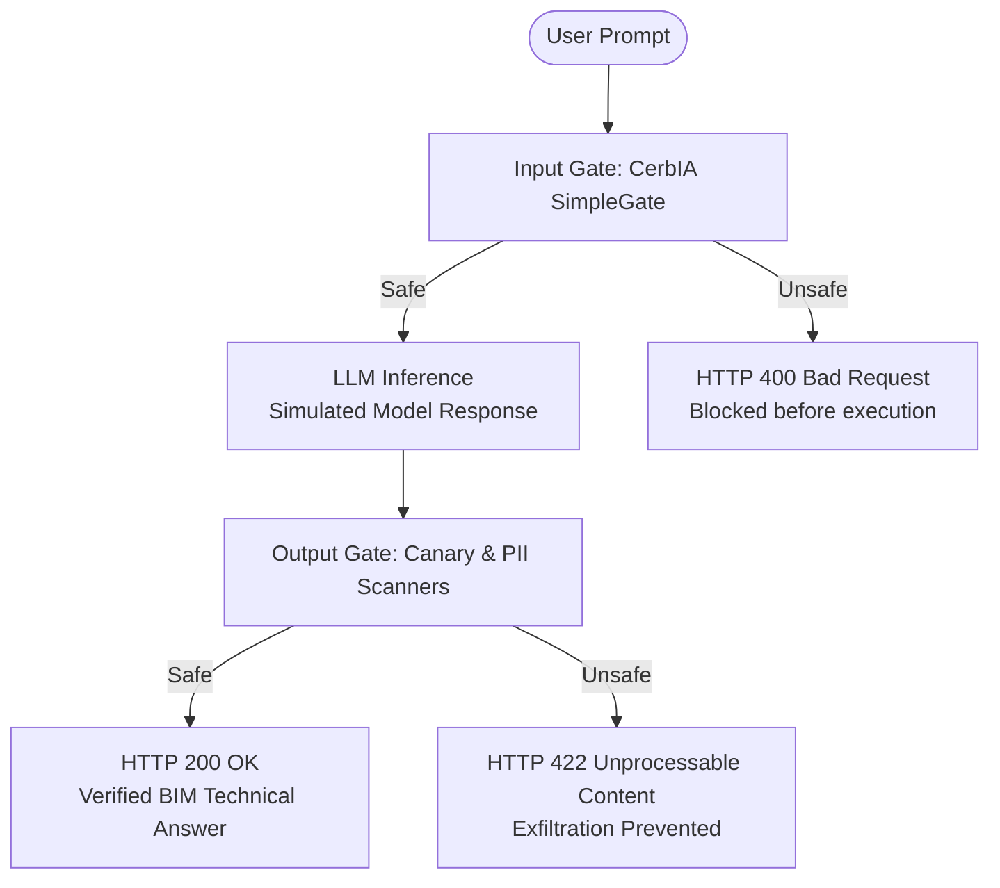

<!--
SPDX-FileCopyrightText: 2026 Jose Manuel Caamaño González (jmcaamanog)
SPDX-FileCopyrightText: 2026 INDUSTRIA DE DISEÑO TEXTIL S.A. (INDITEX S.A.)

SPDX-License-Identifier: Apache-2.0
-->

# FastAPI BIM Common Data Environment (CDE) Guardrail

This example demonstrates how to integrate **CerbIA** as input and output security checks in a **FastAPI** endpoint for an AI assistant operating within a **BIM Common Data Environment (CDE)**.

In multi-tenant, multi-package construction and store roll-out projects, subcontractors, engineering firms, and BIM coordinators query project knowledge bases, federated IFC models, and technical specifications. This illustrative example demonstrates securing both **inbound user queries** and **outbound LLM responses** (with simulated model execution).

---

## 🏗️ BIM Work Breakdown Structure (WBS) Matrix

Construction projects segregate management packages (commercial tenders and procurement) from BIM technical modeling disciplines:

| Package Code | Package Name | Discipline Code | Discipline Name |
| :--- | :--- | :---: | :--- |
| `200HVAC` | HVAC & Mechanical Works | `HVAC` | Heating, Ventilation & Air Conditioning |

---

## 🛡️ Security Architecture: Threat Model & Guardrails



### Protection Scenarios:
1. **Scope Override / Prompt Injection**: A contractor attempts jailbreaking the AI to bypass rules, override coordination clearances, or approve alterations without proper review.
   - *Protected by*: `PromptInjectionScanner` & `KeywordScanner`.
2. **Confidential Tender Budget Protection (Canary Tokens)**: The example generates a canary token for a confidential tender reference and scans the simulated response for that token.
   - *Protected by*: `CanaryLeakScanner`.
3. **Subcontractor Personal Data (PII)**: Daily site incident reports containing unredacted Spanish DNI, passport numbers, personal phones, or emails.
   - *Protected by*: `PiiScanner`.
4. **Malicious URLs**: Submittal document links or external URLs with untrusted/suspicious TLDs (`.xyz`, phishing domains).
   - *Protected by*: `MaliciousUrlScanner`.

---

## 🚀 Running the Example

From the repository root, install the example dependencies with
`uv sync --group examples`. These heuristic checks do not certify responses as
safe or enforce BIM authorization rules.

### 1. Execute Automated Pytest Suite

Run the test suite:

```bash
uv run --no-sync pytest examples/fastapi-bim-guardrail/test_scenarios.py
```

### 2. Run the Live FastAPI Server

Start the API service with Uvicorn:

```bash
uv run --no-sync uvicorn --app-dir examples/fastapi-bim-guardrail app:app --reload
```

Interactive OpenAPI documentation is available at `http://localhost:8000/docs`.

---

## 📁 File Structure

* `bim_matrix.py`: Typed data model of the illustrative BIM WBS package and discipline.
* `app.py`: FastAPI server implementing input and output gates.
* `test_scenarios.py`: Pytest test suite validating input safety and output leak prevention.
* `README.md`: Technical documentation and setup instructions.
