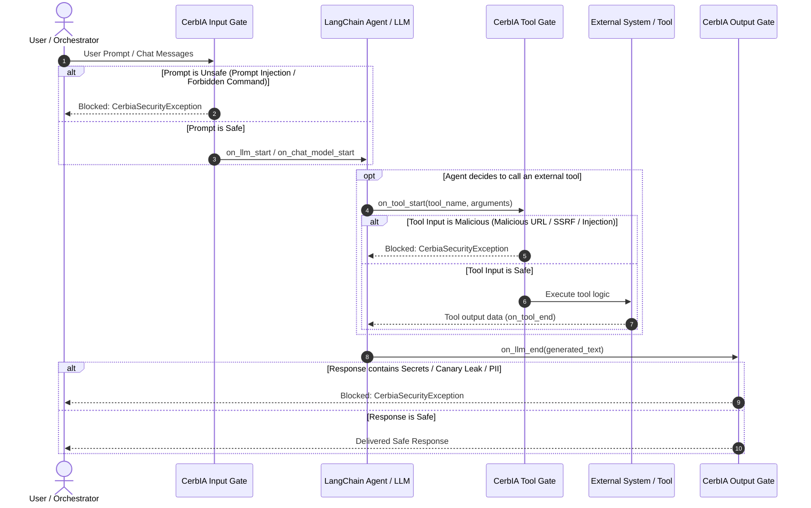

<!--
SPDX-FileCopyrightText: 2026 INDUSTRIA DE DISEÑO TEXTIL S.A. (INDITEX S.A.)

SPDX-License-Identifier: Apache-2.0
-->

# LangChain Agent Guardrail with CerbIA

This example demonstrates how to integrate **CerbIA** into **LangChain** and autonomous agent orchestration pipelines using a custom callback handler (`CerbiaCallbackHandler`).

It implements a comprehensive security perimeter protecting autonomous AI agents against:
- **OWASP LLM01: Prompt Injection**: Intercepts direct prompt overrides, jailbreaks, and zero-width invisible text at the prompt boundary before LLM inference.
- **OWASP LLM02: Sensitive Information Disclosure**: Prevents confidential tokens, canary strings, PII, and infrastructure secrets from leaking in LLM responses.
- **OWASP LLM06: Excessive Agency & Unsafe Tool Execution**: Validates tool invocation parameters before execution (blocking malicious URLs, SSRF, command injection) and inspects external tool outputs to prevent **Indirect Prompt Injection**.

---

## Architecture & Multi-Boundary Guardrails



---

## Key Features

1. **Native Callback Compatibility**:
   - Implements LangChain's `BaseCallbackHandler` interface (`on_llm_start`, `on_chat_model_start`, `on_llm_end`, `on_tool_start`, `on_tool_end`).
   - Includes duck-typed fallback support when `langchain-core` is not pre-installed.
2. **Granular Boundary Enforcement**:
   - `input_gate`: Checks prompts and chat messages before model execution.
   - `tool_gate`: Inspects tool arguments before invoking external functions or web services.
   - `tool_output_gate`: Sanitizes external tool outputs to shield against indirect prompt injections embedded in retrieved data.
   - `output_gate`: Scans LLM generations for secret leaks, canary tokens, and PII.
3. **Flexible Enforcement Modes**:
   - **Enforcement Mode (`raise_error=True`)**: Immediately interrupts agent flow with `CerbiaSecurityException` on security violations.
   - **Audit Mode (`raise_error=False`)**: Records security findings and risk scores into `handler.history` without interrupting execution, enabling telemetry and compliance auditing.

---

## Getting Started

### 1. Requirements

Ensure you are in the CerbIA workspace environment:

```bash
uv sync
```

### 2. Run the Interactive Demonstration

Run the reference agent scenario illustrating safe interactions, prompt injection blocking, canary leak prevention, and tool parameter protection:

```bash
python examples/langchain-agent-guardrail/agent.py
```

Expected output:

```text
=== CerbIA LangChain Agent Guardrail Demo ===

[Scenario 1] Safe user request:
Agent response: Store information: Store MADRID-GRANVIA: {'area_m2': 4500, 'floors': 5, 'hvac_spec': 'Chiller-Central'}

[Scenario 2] Prompt injection attack:
Intercepted by CerbIA! Boundary: input | Rationale: Prompt Injection: Injection detected (1 match(es)): [instruction_override] 'Ignore previous instructions'

[Scenario 3] Model attempts to leak confidential canary token:
Intercepted by CerbIA! Boundary: output | Rationale: Canary Leak: Canary token leaked (1 full)

[Scenario 4] Malicious tool target intercepted at tool boundary:
Intercepted by CerbIA! Boundary: tool_input | Rationale: Malicious URL: Suspicious URL(s) (1 flag(s)): Suspicious TLD (.xyz) (http://malicious-bim-phishing.xyz/update.exe)

Audit Summary: {'total_scans': 7, 'blocked_scans': 3, 'safe_scans': 4, 'boundaries': {'tool_input': 1, 'output': 1, 'tool_output': 0, 'input': 1}}
```

### 3. Run the Unit Test Suite

Run the full pytest suite for the callback handler and agent guardrails:

```bash
pytest examples/langchain-agent-guardrail/test_agent.py -v
```

---

## Code Example: Using `CerbiaCallbackHandler`

```python
from cerbia.core.scanners import (
    CanaryLeakScanner,
    MaliciousUrlScanner,
    PromptInjectionScanner,
    SecretScanner,
)
from cerbia.core.score_aggregators import MaxScoreAggregator
from cerbia.core.security_gate import SecurityGate
from cerbia_callback import CerbiaCallbackHandler

# 1. Define input security gate
input_gate = SecurityGate(
    name="agent-input",
    scanners=[PromptInjectionScanner()],
    score_aggregator=MaxScoreAggregator(),
)

# 2. Define output security gate
output_gate = SecurityGate(
    name="agent-output",
    scanners=[SecretScanner(), CanaryLeakScanner(canary_tokens=["MY-CANARY-TOKEN"])],
    score_aggregator=MaxScoreAggregator(),
)

# 3. Define tool security gate
tool_gate = SecurityGate(
    name="agent-tool-input",
    scanners=[MaliciousUrlScanner()],
    score_aggregator=MaxScoreAggregator(),
)

# 4. Initialize CerbIA callback handler
cerbia_handler = CerbiaCallbackHandler(
    input_gate=input_gate,
    output_gate=output_gate,
    tool_gate=tool_gate,
    raise_error=True,
)

# 5. Pass callback handler to your LangChain LLM or Agent Executor:
# llm = ChatOpenAI(callbacks=[cerbia_handler])
# agent_executor.invoke({"input": user_prompt}, config={"callbacks": [cerbia_handler]})
```
