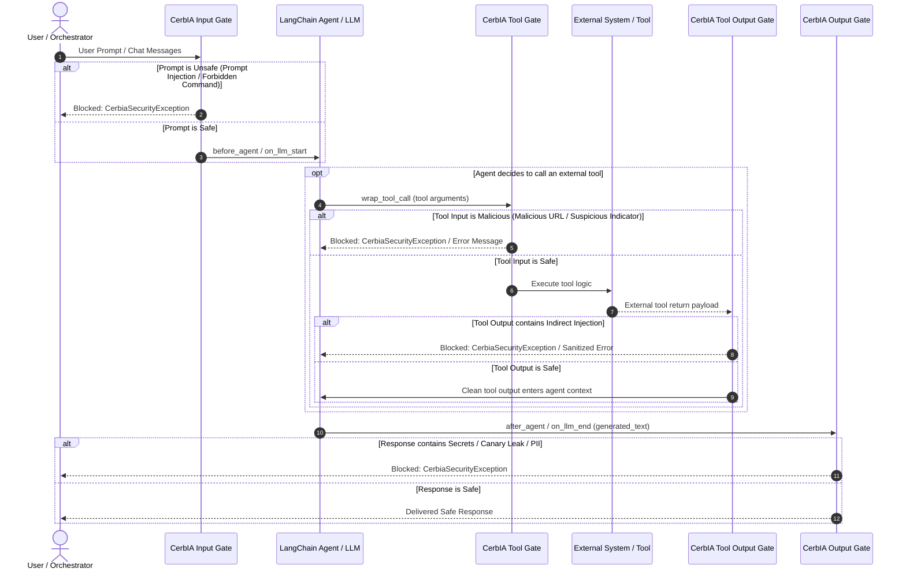

<!--
SPDX-FileCopyrightText: 2026 INDUSTRIA DE DISEÑO TEXTIL S.A. (INDITEX S.A.)

SPDX-License-Identifier: Apache-2.0
-->

# LangChain Agent Guardrail with CerbIA

This example demonstrates how to integrate **CerbIA** into **LangChain** and autonomous agent orchestration pipelines using **Agent Middleware** (`CerbiaAgentMiddleware`) and custom callbacks (`CerbiaCallbackHandler`).

It implements a comprehensive security perimeter protecting autonomous AI agents against:
- **OWASP LLM01: Prompt Injection**: Intercepts direct prompt overrides, jailbreaks, and zero-width invisible text at the prompt boundary before LLM inference.
- **OWASP LLM02: Sensitive Information Disclosure**: Prevents confidential tokens, canary strings, PII, and infrastructure secrets from leaking in LLM responses.
- **Tool input and output checks**: Scans tool arguments for suspicious URL and prompt-injection indicators, and can scan external tool outputs for indirect prompt injection when a tool-output gate is configured. Real tools must separately enforce destination restrictions and safe argument handling.

---

## Architecture & Multi-Boundary Guardrails



---

## Key Features

1. **Native Agent Middleware (`CerbiaAgentMiddleware`)**:
   - Implements LangChain's recommended `AgentMiddleware` architecture (`before_agent`, `wrap_tool_call`, `after_agent`).
   - Allows fine-grained control over whether a tool executes and whether external results enter the agent state.
2. **Callback Compatibility (`CerbiaCallbackHandler`)**:
   - Implements LangChain's `BaseCallbackHandler` interface (`on_llm_start`, `on_chat_model_start`, `on_llm_end`, `on_tool_start`, `on_tool_end`).
   - Supports both plain-string and structured message blocks (such as `[{"type": "text", "text": ...}]`) with raw unicode extraction for zero-width stealth attacks.
3. **Granular Boundary Enforcement**:
   - `input_gate`: Checks prompts and chat messages before model execution.
   - `tool_gate`: Inspects tool arguments before invoking external functions or web services.
   - `tool_output_gate`: Sanitizes external tool outputs to shield against indirect prompt injections embedded in retrieved data.
   - `output_gate`: Scans LLM generations for secret leaks, canary tokens, and PII.
4. **Flexible Enforcement Modes**:
   - **Enforcement Mode (`raise_error=True`)**: Immediately interrupts agent flow with `CerbiaSecurityException` on security violations.
   - **Audit / Soft-Intervention Mode (`raise_error=False`)**: Records security findings and risk scores into audit history, blocks tool execution, and returns descriptive error messages into the agent context without terminating execution.

---

## Getting Started

### 1. Requirements

Ensure you are in the CerbIA workspace environment:

```bash
uv sync
```

### 2. Run the Interactive Demonstration

Run the reference agent scenario illustrating safe interactions, prompt injection blocking, canary leak prevention, tool parameter protection, and indirect prompt injection interception:

```bash
python examples/langchain-agent-guardrail/agent.py
```

Expected output:

```text
=== CerbIA LangChain Agent Guardrail Demo ===

[Scenario 1] Safe user request:
Agent response: Store information: Store MADRID-GRANVIA: {'area_m2': 4500, 'floors': 5, 'hvac_spec': 'Chiller-Central'}

[Scenario 2] Prompt injection attack:
Intercepted by CerbIA! Boundary: input | Rationale: Prompt Injection: Injection detected (1 match(es)): [instruction_override] 'Ignore previous instructions'

[Scenario 3] Model attempts to leak confidential canary token:
Intercepted by CerbIA! Boundary: output | Rationale: Canary Leak: Canary token leaked (1 full)

[Scenario 4] Malicious tool target intercepted at tool boundary:
Intercepted by CerbIA! Boundary: tool_input | Rationale: Malicious URL: Suspicious URL(s) (1 flag(s)): Suspicious TLD (.xyz) (http://malicious-bim-phishing.xyz/update.exe)

[Scenario 5] Indirect prompt injection in tool output intercepted:
Intercepted by CerbIA! Boundary: tool_output | Rationale: Prompt Injection: Injection detected (1 match(es)): [instruction_override] 'Ignore previous instructions'

Audit Summary: {'total_scans': 10, 'blocked_scans': 4, 'safe_scans': 6, 'boundaries': {'input': 1, 'tool_output': 1, 'tool_input': 1, 'output': 1}}
```

### 3. Run the Unit Test Suite

Run the full pytest suite for the middleware, callback handler, and agent guardrails:

```bash
pytest examples/langchain-agent-guardrail/test_agent.py -v
```

---

## Code Example: Using `CerbiaAgentMiddleware` and `CerbiaCallbackHandler`

```python
from cerbia.core.scanners import (
    CanaryLeakScanner,
    InvisibleTextScanner,
    KeywordScanner,
    MaliciousUrlScanner,
    PiiScanner,
    PromptInjectionScanner,
    SecretScanner,
)
from cerbia.core.scanners.base import Action
from cerbia.core.score_aggregators import MaxScoreAggregator
from cerbia.core.security_gate import SecurityGate
from cerbia_callback import CerbiaCallbackHandler
from cerbia_middleware import CerbiaAgentMiddleware

# 1. Define input security gate
input_gate = SecurityGate(
    name="agent-input",
    scanners=[
        PromptInjectionScanner(),
        InvisibleTextScanner(),
        KeywordScanner(
            extra_patterns=[
                ("db_manipulation", "drop database"),
                ("command_execution", "rm -rf"),
                ("shell_execution", "exec xp_cmdshell"),
            ]
        ),
    ],
    score_aggregator=MaxScoreAggregator(),
)

# 2. Define tool security gate (tool arguments)
tool_gate = SecurityGate(
    name="agent-tool-input",
    scanners=[MaliciousUrlScanner(), PromptInjectionScanner()],
    score_aggregator=MaxScoreAggregator(),
)

# 3. Define tool output security gate (indirect prompt injection)
tool_output_gate = SecurityGate(
    name="agent-tool-output",
    scanners=[PromptInjectionScanner()],
    score_aggregator=MaxScoreAggregator(),
)

# 4. Define output security gate
output_gate = SecurityGate(
    name="agent-output",
    scanners=[
        SecretScanner(),
        PiiScanner(action=Action.BLOCK),
        CanaryLeakScanner(canary_tokens=["MY-CANARY-TOKEN"]),
    ],
    score_aggregator=MaxScoreAggregator(),
)

# 5. Initialize CerbIA Agent Middleware (recommended for agent architectures)
cerbia_middleware = CerbiaAgentMiddleware(
    input_gate=input_gate,
    output_gate=output_gate,
    tool_gate=tool_gate,
    tool_output_gate=tool_output_gate,
    raise_error=True,
)

# 6. Initialize CerbIA Callback Handler (for standard LLMs / callback hooks)
cerbia_handler = CerbiaCallbackHandler(
    input_gate=input_gate,
    output_gate=output_gate,
    tool_gate=tool_gate,
    tool_output_gate=tool_output_gate,
    raise_error=True,
)
```
